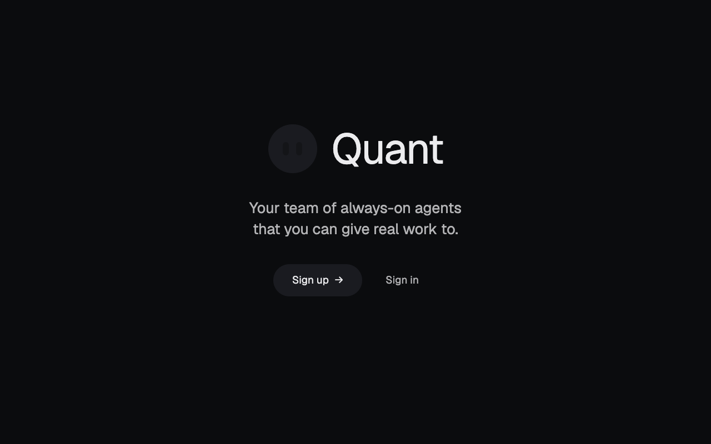
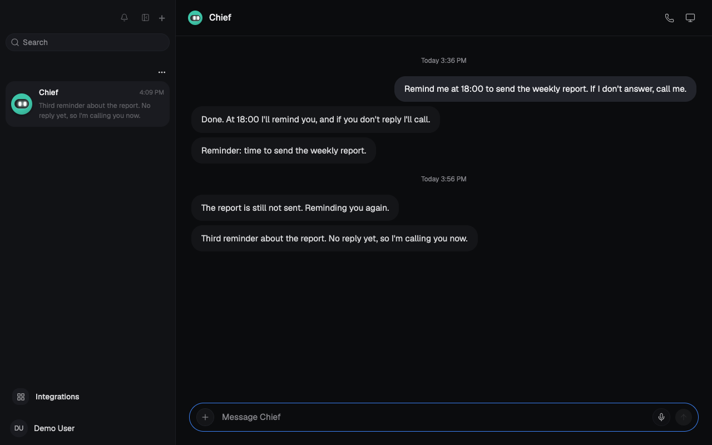
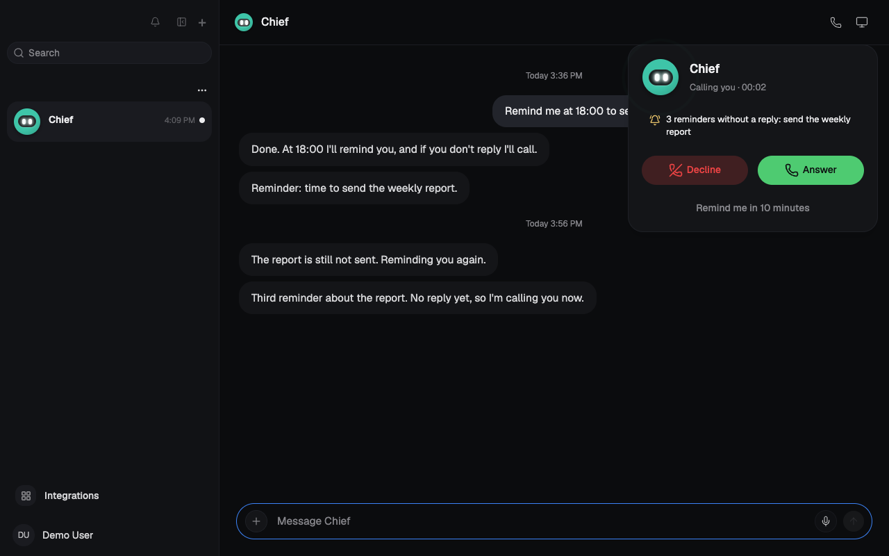
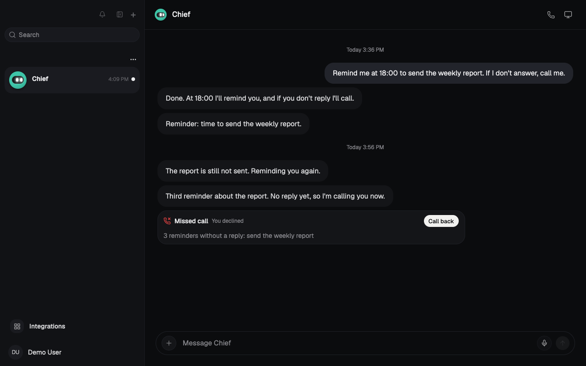

<p align="center">
  
</p>

<h1 align="center">Quant</h1>

<p align="center">
  <b>An open-source AI assistant with persistent bots that you host yourself.</b><br>
  Chat with your bots, call them, let them call you back, and give them their own computers.<br>
  It runs on your server behind a password, with apps for the web, Android, macOS, Windows and Linux.
</p>

<p align="center">
  
  
  
  
  
  
  
  
  
</p>

<p align="center">
  <a href="#features">Features</a> ·
  <a href="#stack">Stack</a> ·
  <a href="#deploy-on-a-server">Deploy</a> ·
  <a href="#install-the-apps">Apps</a> ·
  <a href="#deploy-with-an-ai-agent">Deploy with an agent</a> ·
  <a href="#development">Development</a> ·
  <a href="#documentation">Documentation</a> ·
  <a href="#license">License</a>
</p>

<br>

<table>
  <tr>
    <td width="25%" valign="top">
      <h3>📞 Calls both ways</h3>
      Call a bot from any chat and talk to it like on the phone. A bot can call you too, when you ask it to or when its reminders go unanswered.
    </td>
    <td width="25%" valign="top">
      <h3>🏠 Your server, your password</h3>
      One installer starts Quant with Docker behind a Basic Auth gate. Your chats, keys and files stay in your database.
    </td>
    <td width="25%" valign="top">
      <h3>🔄 One-button updates</h3>
      Every change on <code>main</code> becomes a release. The server, the Android app and the desktop apps update themselves from it with one button.
    </td>
    <td width="25%" valign="top">
      <h3>🤖 Agent-ready</h3>
      The repo ships its own agent instructions, a mandatory code style and a one-command quality gate, so an AI agent can deploy and extend it from a single prompt.
    </td>
  </tr>
</table>

<br>

<table>
  <tr>
    <td width="25%"></td>
    <td width="25%"></td>
    <td width="25%"></td>
    <td width="25%"></td>
  </tr>
  <tr>
    <td align="center"><sub>Welcome</sub></td>
    <td align="center"><sub>Reminders in a chat</sub></td>
    <td align="center"><sub>The bot calls you</sub></td>
    <td align="center"><sub>Missed call</sub></td>
  </tr>
</table>

<sub>Screenshots show the dark theme with demo data.</sub>

> [!NOTE]
> The web interface is available in **English, Russian, German, Spanish, French, Portuguese (Brazil), Turkish, Hindi, Korean and Simplified Chinese**; the Android app in **English, Russian, German and Simplified Chinese**. Quant follows the browser or system language, and you can switch it in the account settings. The guides come in both English and Russian: [English](docs/en/) and [Русский](docs/ru/).

> [!WARNING]
> **Without a domain, Quant runs over plain HTTP** on your network: the gate password crosses it unencrypted, and browsers on other devices block the microphone. Use a domain with HTTPS, a VPN or a network you trust. The update service holds the Docker socket, which equals root on the server.

## Features

<table>
  <tr>
    <td width="50%" valign="top">
      <h3>Persistent bots</h3>
      Each bot keeps its own conversation, memory, reminders and history, can delegate to other bots, and works on a computer with a browser, terminal and files. Models come from your own provider keys.
      <br><br>
      See <a href="docs/en/install.md">installing a server</a>.
    </td>
    <td width="50%" valign="top">
      <h3>Calls and dictation</h3>
      A phone button starts a call with ringing, a timer and mute. Hold the microphone to dictate a message and release to send. Camera and screen sharing show a local preview only; the bot does not see them yet.
      <br><br>
      See <a href="docs/en/calls.md">calls and voice</a>.
    </td>
  </tr>
  <tr>
    <td width="50%" valign="top">
      <h3>The bot calls you</h3>
      A bot rings every open Quant screen when you asked it to call or ignored three reminders. Answer, decline or ask it to call back in 10 minutes. A closed app cannot ring; the missed call waits in the chat.
      <br><br>
      See <a href="docs/en/calls.md#when-the-bot-calls-you">when the bot calls you</a>.
    </td>
    <td width="50%" valign="top">
      <h3>Apps for every device</h3>
      The Android app and the desktop apps connect to your server with its address and gate password, stored in the system keychain. A desktop app can also run a private local instance.
      <br><br>
      See <a href="docs/en/connect.md">connecting the apps</a>.
    </td>
  </tr>
  <tr>
    <td width="50%" valign="top">
      <h3>Updates from GitHub</h3>
      <b>Settings → Updates</b> moves the server to the newest release, Android installs the new APK from <b>Account → Check for updates</b>, and the desktop apps update on restart. On macOS the app opens the new download instead, because it is not signed by Apple.
      <br><br>
      See <a href="docs/en/updates.md">updates</a>.
    </td>
    <td width="50%" valign="top">
      <h3>Operations</h3>
      Status, logs, password and port changes, backups and removal are a few Docker Compose commands in the install folder.
      <br><br>
      See <a href="docs/en/operations.md">operations</a>.
    </td>
  </tr>
</table>

## Stack

- **Backend:** TypeScript 7.0 on Node.js (22.22.2+, 24 or 26), Hono 4.13 and oRPC 1.15, PostgreSQL 16 with Prisma 7.10, Graphile Worker for background jobs.
- **Web:** React 19.2, Vite 8.3 and Tailwind CSS 4.3, translated with Lingui.
- **Apps:** Electron 44 for macOS, Windows and Linux; Expo 57 with React Native 0.86 for Android.
- **Runtime:** Docker Compose with Caddy 2 as the Basic Auth gate. Bot computers are Docker containers on the same host. Images for `linux/amd64` and `linux/arm64` come from `ghcr.io/quant-ai-assistant/quant-core`.
- **Quality:** Biome, TypeScript and Vitest, run by GitHub Actions on every push and pull request.

## Deploy on a server

You need Linux or macOS with Docker Engine and the Docker Compose plugin, `curl` and `openssl`.

```sh
mkdir -p quant && cd quant
curl -fsSLO https://raw.githubusercontent.com/Quant-Ai-Assistant/Quant-Core/main/infra/compose/install-images.sh
bash install-images.sh
```

The installer asks for an optional domain, a port (it refuses busy ones), the address other devices use and the gate username and password, then starts Quant and prints its address. Open it, enter the gate credentials, create the first account (it owns the server) and connect a model provider.

| What | Address |
| --- | --- |
| Quant over plain HTTP | `http://<server address>:<port>`, `8080` by default |
| Quant with a domain | `https://<domain>` |
| Install folder | `.env`, `docker-compose.images.yml`, `Caddyfile.gate` |

Before you rely on it, review:

- **Password:** a generated gate password is printed once. Save it; every device needs it.
- **Sign-up:** anyone who passes the gate can create an account. After yours, set `SIGNUPS_ENABLED=false` in `.env`.
- **Ports:** only the gate is published. With a domain it needs ports 80 and 443.
- **Backups:** keep `.env` with your database dumps; its `ENCRYPTION_KEY` unlocks the stored provider keys.

## Install the apps

All files are on the [latest release](https://github.com/Quant-Ai-Assistant/Quant-Core/releases/latest). Each app asks for the server address and the gate username and password once.

**Android**

1. Download `quant.apk` on the phone and open it. Allow installs from your browser or file manager when Android asks.
2. Start Quant, tap **Use a custom server**, enter the address, the username and the password, and tap **Save**.

**macOS**

1. Download the `.dmg` (`arm64` for Apple Silicon, `x64` for Intel) and drag **Quant** into **Applications**.
2. Start it. macOS says it cannot verify the developer: click **Done**, then **System Settings → Privacy & Security → Open Anyway**. Or run `xattr -dr com.apple.quarantine /Applications/Quant.app`.
3. Choose **Existing instance** and enter the address, the username and the password.

**Windows and Linux**

| System | File | First launch |
| --- | --- | --- |
| Windows 10 and 11 | `.exe` | SmartScreen: **More info → Run anyway** |
| Linux | `.AppImage` | `chmod +x` the file, then run it |

## Deploy with an AI agent

Any coding agent that can run shell commands (Claude Code, Codex, Cursor and similar) can do the whole install. Open an empty folder on the server in the agent and paste:

```text
Deploy Quant on this machine.

1. Clone https://github.com/Quant-Ai-Assistant/Quant-Core and work inside it.
2. Read AGENTS.md and the "Deploy on a server" section of README.md, and follow them exactly.
3. Check that Docker Engine with the Compose plugin, curl and openssl are installed.
   If something is missing, stop and tell me what to install.
4. Create a separate install folder outside the clone and download install-images.sh
   from the latest release into it.
5. Ask me for the port, the address other devices will use, an optional HTTPS domain and the
   gate username, then run install-images.sh with QUANT_PORT, QUANT_PUBLIC_HOST, QUANT_DOMAIN
   and QUANT_BASIC_USER set. Leave QUANT_BASIC_PASSWORD unset so the installer generates it.
6. Verify: `docker compose --env-file .env -f docker-compose.images.yml ps` shows every service
   running, and the address answers 401 without credentials and 200 with them.
7. Report the address, the username, the choices you made and anything you skipped.

Do not commit .env or any secret, do not print the gate password more than once, and do not
turn off the gate or open sign-up rules unless I ask.
```

For agents working on the code itself, [`AGENTS.md`](AGENTS.md) and [`CLAUDE.md`](CLAUDE.md) carry the project rules, [`CodeStyle.md`](CodeStyle.md) is the mandatory standard, and `pnpm gate` is the gate that has to pass before a push.

## Development

```sh
pnpm install   # dependencies for every app and package
pnpm dev       # API, worker, web and computer supervisor on http://127.0.0.1:5173
pnpm gate      # Prisma client, Biome lint, TypeScript and unit tests
```

`pnpm dev` needs a filled `.env` and a running Postgres; see [development](docs/en/development.md) for the full first run.

Where things live:

- **Web interface:** `apps/web`
- **Server and jobs:** `apps/api`, `apps/worker`
- **Android app:** `apps/mobile`
- **Desktop app:** `apps/desktop`
- **Shared logic and contracts:** `packages/core`, `packages/contracts`
- **Agent runtime:** `packages/adapters`
- **Self-host:** `infra/compose`, `infra/updater`
- **Releases:** `.github/workflows/release.yml`

[`CodeStyle.md`](CodeStyle.md) is mandatory for human developers and AI agents alike. Read it before implementing anything, and cite rule numbers in reviews.

## Documentation

Every guide exists in English ([`docs/en`](docs/en/)) and in Russian ([`docs/ru`](docs/ru/)). The links below lead to the English versions.

| Document | Covers |
| --- | --- |
| [Install a Quant server](docs/en/install.md) | Requirements, installer questions, services, files, HTTPS, first steps |
| [Connect the apps](docs/en/connect.md) | Browser, Android, macOS, Windows, Linux, local instance |
| [Updates](docs/en/updates.md) | Server updater, Android updates, desktop updates, versions |
| [Calls and voice](docs/en/calls.md) | Calling a bot, dictation, bot-initiated calls, limits |
| [Operations](docs/en/operations.md) | Logs, restart, gate password, port, backups, removal, security |
| [Development](docs/en/development.md) | Running from source, checks, code layout, releases, upstream |

## License

Quant is free software, licensed under the [GNU Affero General Public License v3.0 or later](LICENSE) (AGPL-3.0-or-later).
Copyright (c) 2026 Quant-Ai-Assistant and the Quant contributors.

In plain words:

- **You may** use, study, change, share and even sell it.
- **You must** keep it open: if you distribute it, or run a modified version as a service that other people use over a network, you have to give them the complete source code of your version under the same license.
- **You may not** turn it, or anything built from it, into a closed-source product.

This summary is not a substitute for the license text. The software comes with no warranty.

Quant is a fork of [Rakazo](https://github.com/elie222/rakazo) by [elie222](https://github.com/elie222) and the Rakazo contributors, and is not affiliated with or endorsed by the Rakazo project. Files in this repository have been modified from the original Rakazo sources; the full history of changes is in the git log.

| Component | License |
| --- | --- |
| Rakazo, © 2026 Rakazo contributors | [Apache License 2.0](LICENSE-APACHE) |
| Geist font, bundled in the web interface | SIL Open Font License 1.1 |
